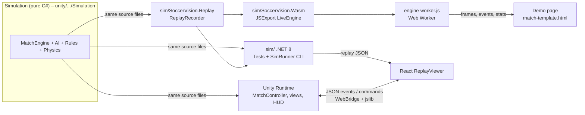

# SoccerVision – Technical Overview (for Idan)

> Status legend: **Confirmed** = read in the code/config. **Inferred** = concluded from the code/docs, not verified at runtime.
> **Unknown** = not present in the repository. No secrets, keys or credentials are included in this document.

## 1. Project

SoccerVision is a football-management game in the style of Football Manager / Hattrick, with fictional players.
**The match itself (gameplay) is a deterministic C# simulation engine**, rendered by Unity (and by two other renderers);
**the rest of the game (squad, tactics, transfers, youth, training) is meant to live in a React shell** (Confirmed: `README.md`,
`docs/ARCHITECTURE.md`). Today the repository contains:

| Area | State |
|---|---|
| Match engine (rules, AI, physics, weather, tactics, cards, injuries, substitutions on injury) | Working, ~10k lines, 109 tests |
| Unity match view + HUD + audio + React bridge | Working (Confirmed in code; not run in this review) |
| React shell | Thin: a Unity tab and a dev "Engine replay" viewer. Squad/transfers/training screens are **not built** (Confirmed) |
| Standalone browser demo page (engine compiled to WebAssembly) | Working, auto-published by CI |
| Server / league / database / accounts | **Does not exist** (Unknown – only mentioned as a future step in `docs/ARCHITECTURE.md`) |

Main technical responsibilities: simulate a 90-minute match (IFAB laws, AI decisions, ball physics), play it in real time
for a viewer who can change tactics live, and record it as replay data.

## 2. Tech Stack

| Layer | Technology | Status |
|---|---|---|
| Match engine | Pure C# (`netstandard2.1`, C# 9, no `UnityEngine` references), own RNG (PCG32) and `Vec2` | Confirmed |
| Gameplay rendering | Unity 6.3 LTS (`6000.3.27f1`), 2D sprites + IMGUI HUD, WebGL build | Confirmed |
| Frontend shell | React 19, TypeScript 5.9, Vite 7, `react-unity-webgl` 10 | Confirmed (`web/package.json`) |
| Browser demo | One HTML file (canvas) + engine as .NET 8 WebAssembly in a Web Worker | Confirmed |
| Tooling | .NET 8 SDK, xUnit tests, Python 3 (build scripts), Node (esbuild bundles), Bash | Confirmed |
| Backend / API / database | **None** | Confirmed (no server code exists) |
| Authentication | **None** | Confirmed |
| Hosting | GitHub: the CI publishes the demo to the `demo` branch (served via raw.githack.com or GitHub Pages) | Confirmed (workflow, README) |
| External services | Team generator API `https://soccer-simulation.onrender.com/api/team` (used once, by hand, to create `data/teams/*.json`); Google Fonts on the demo page | Confirmed |

## 3. Architecture

One engine, several consumers. The engine is the single source of truth for football logic.



Key facts:

- **Determinism**: a seed gives the same match on every runtime (own RNG, own `Vec2`). Floating point may still differ slightly between WASM and native (Inferred; noted in the changelog).
- **Time model**: `MatchEngine.Advance(realSeconds)` runs fixed 0.02 s physics steps; a half is 600 real seconds = 45 clock minutes (clock speed 4.5×). See `docs/ARCHITECTURE.md`.
- **Replay format** (Confirmed): integer frames of 128 numbers each (header 9, 22 players × 5, 3 officials × 3), plus events JSON and per-second stats rows. Written by `ReplayRecorder`, shared by the CLI and the browser build.
- **Three renderers** draw the same replay/engine state and must stay visually consistent: Unity (`Runtime/Rendering`), React (`web/src/replay/drawPitch.ts`), demo page (`tools/demo-page/match-template.html`). Every visual change is currently made three times (see risks).

## 4. Codebase

| Path | Responsibility | Start here? |
|---|---|---|
| `unity/SoccerVision/Assets/SoccerVision/Simulation/` | The engine. `Core/` (config, `MatchConditions`, `MatchScript`, `Pitch`, RNG), `Engine/` (`MatchEngine*.cs`, `TeamAgent`, `PlayerAgent`, `BallPhysics`, set pieces, rules, injuries, `ComputerManager`), `AI/` (`MatchEngine.TeamAI.cs` shape/marking/movement, `MatchEngine.OnBall.cs` decisions, goalkeeper), `Model/` (`TeamSetup` incl. `TeamTactics`, `PlayerAttributes`, `Formation`), `Events/` (events + commentary), `Demo/` (`DemoTeams`, generated squads) | **Yes – read `Engine/MatchEngine.cs` first** |
| `docs/ARCHITECTURE.md` | Time model, per-step pipeline, bridge contract, next steps | **Yes – read second** |
| `sim/` | .NET 8 solution compiling the same engine sources (`SoccerVision.Simulation.csproj` links the Unity folder). `…Tests` (xUnit), `…SimRunner` (calibration table, timelines, replay export), `…Replay` (`ReplayRecorder`), `…Wasm` (browser engine) | Run the tests / SimRunner early |
| `unity/.../Runtime/` | `MatchController` (match lifecycle), `Rendering/` (pitch, player/ball/official views), `MatchHud.cs` (IMGUI HUD), `Audio/`, `Bridge/` (`BridgeProtocol.cs`, `WebBridge.cs`), `MatchLook.cs` (weather/colour settings) | When touching visuals |
| `unity/.../Editor/SoccerVisionMenu.cs` | Menu: "Create Match Scene", "Build WebGL for React" | Build only |
| `web/src/` | `App.tsx` (tabs), `unity/UnityMatch.tsx`, `replay/` (`ReplayViewer.tsx`, `drawPitch.ts`, `replay.ts`, `ball3d.ts`, `textures.ts`), `components/`, `settings/devSettings.ts`, `bridge/protocol.ts` (mirrors `BridgeProtocol.cs`), `audio/matchAudio.ts` | React work |
| `web/vite.config.ts` | Dev-only plugin: `GET /api/new-replay` spawns `dotnet run` of SimRunner and returns replay JSON | Dev tooling |
| `tools/demo-page/` | `match-template.html` (the whole demo UI + renderer), `engine-worker.js`, `build.sh`, `build_page.py` | **Yes – best place to see the engine working** |
| `tools/teams/build_teams.py`, `data/teams/*.json` | Turns generator JSON into `Simulation/Demo/GeneratedTeams.cs` (auto-generated; do not hand-edit) | Data pipeline |
| `.github/workflows/publish-demo.yml` | CI: build and publish the demo | CI |
| `CHANGELOG.md`, `README.md` | History per branch, run instructions | Read |

Suggested reading order: `README.md` → `docs/ARCHITECTURE.md` → `Engine/MatchEngine.cs` (`Step`, `StepLive`, commands) →
`AI/MatchEngine.TeamAI.cs` (`UpdateTeamShape`, `ComputeShapeTarget`) → `AI/MatchEngine.OnBall.cs` (`ChooseAction`) →
`Model/TeamSetup.cs` (`TeamTactics.Effective()`) → one test file in `sim/…Tests`.

## 5. Main Flow – a live tactic change (demo page)

"Live match": the user is the home team vs the computer. The user changes a tactic and the players follow it at once.

```
User clicks "Offside trap"  (.tac-seg button)
  → match-template.html: tacChanged()  [debounced 600 ms]            (tools/demo-page/match-template.html)
  → worker.postMessage({cmd:"tactics", defence, attack, special, line, width, ...})
  → engine-worker.js: L.SetTactics(...)                              (tools/demo-page/engine-worker.js)
  → LiveEngine.SetTactics → MakeTactics → engine.Submit(new ChangeTacticsCommand(0, …))   (sim/SoccerVision.Wasm/Program.cs)
  → MatchEngine.ProcessCommands → ApplyTactics → TeamAgent.Tactics setter → Eff = Tactics.Effective()
                                                                     (Engine/MatchEngine.cs, Engine/TeamAgent.cs, Model/TeamSetup.cs)
  → AI reads team.Eff (and team.Tactics.Defence for style behaviour): UpdateTeamShape / ChooseAction / restarts
                                                                     (AI/MatchEngine.TeamAI.cs, AI/MatchEngine.OnBall.cs)
  → engine emits TacticsChanged event + moves players
  → ReplayRecorder.Step(): frames + events + stats           (sim/SoccerVision.Replay/ReplayRecorder.cs)
  → worker posts a "chunk" → page appendChunk() → canvas drawing + commentary ("Red Rovers change their tactics: …")
```

Also in the live loop: `ComputerManager.Update()` (called after every `Step`) lets the away team answer the human's
tactics and the score every few match minutes (`Engine/ComputerManager.cs`). The page tells the worker how far the viewer
has played (`progress` messages) so the engine stays about 2 s ahead (live pacing).

## 6. Development & Deployment

**Run locally**

| Goal | Command |
|---|---|
| Engine tests (~25-30 min for the whole suite) | `cd sim && dotnet test` |
| Calibration table vs. real football stats | `cd sim && dotnet run -c Release --project SoccerVision.SimRunner -- --matches 100` |
| Try tactics | `... -- --matches 60 --seed 900 --home "defence=trap,line=0.9" --away "attack=long"` |
| Demo page | `tools/demo-page/build.sh`, then serve `docs/` with any static server (a Worker needs `http://`, not `file://`) |
| React shell | `cd web && npm install && npm run dev` (replay tab needs the .NET 8 SDK) |
| Unity | Open `unity/SoccerVision` in Unity 6.3 LTS; Play; "SoccerVision > Build WebGL for React" writes into `web/public/unity/` |
| Regenerate squads | `python3 tools/teams/build_teams.py` (reads `data/teams/*.json`) |

**Environment variables**: none are read by the application code (Confirmed by search). The only secret-like value is the
CI's `GITHUB_TOKEN` (provided by GitHub Actions, used to push the `demo` branch).

**Build / CI/CD** (Confirmed, `.github/workflows/publish-demo.yml`): on **every push to any branch except `demo`**, CI installs
.NET 8 + Node 20, runs `tools/demo-page/build.sh` (publishes the WASM engine into a content-hashed folder
`docs/engine/<version>/`, bundles audio/textures with esbuild, assembles `docs/index.html`) and force-pushes the result to the
`demo` branch with a `BUILD.txt`. **CI does not run the tests** (see risks).

## 7. Important Things Idan Should Know

**Architectural decisions (Confirmed)**
- The engine is engine-agnostic and shared via source linking – never add `UnityEngine` references to `Simulation/`.
- Deterministic by design; keep new randomness on the engine's own RNG (`_rng`), not `System.Random`.
- Tactics have two layers: the manager's values (`TeamAgent.Tactics`) and the **effective** values the AI reads (`team.Eff`). New AI code must read `team.Eff.*` for sliders and `team.Tactics.Defence/Attack/Special` for styles.
- Engine files are served from a content-hashed folder so browsers/CDN never mix a new page with an old engine.

**Technical debt / risks**
- **No CI test gate**: tests exist (109) but only the demo publish runs on push. Full run takes ~28 min.
- **Triple rendering**: Unity, React and the demo page each implement the pitch/player/ball drawing. Changes must be repeated; the three can drift.
- Some behaviour is tuned against real-football statistics (SimRunner table); changes to AI utilities can shift goals/shots/fouls. Re-run calibration. Known gaps in `README.md` (shots, corners, throw-ins).
- Two older calibration tests were loosened for the generated squads (holding-midfielder fouls, winger crosses) – they now check the role, not exact rates.
- The React shell and Unity HUD have no tactics UI yet; the tactics panel exists only on the demo page (Confirmed).
- Squads come from a third-party generator, stored as static JSON; names are not unique within a team (Confirmed).

**Sensitive areas – change carefully**
- `Engine/MatchEngine.cs` (`Step`, phases), `MatchEngine.SetPieces.cs` (restart flow – a bug can stall a match; there is a `MaxSetupSeconds` safety net) and `MatchEngine.Rules.cs`.
- `ReplayRecorder.cs`: the frame/stats layout is a contract with the page and `web/src/replay/replay.ts` (frame length, flag bits, stats row length). Change all consumers together.
- `Runtime/Bridge/BridgeProtocol.cs` ↔ `web/src/bridge/protocol.ts` must stay in sync.
- `.github/workflows/publish-demo.yml` force-pushes the `demo` branch – never put anything by hand there.
- Anything touching determinism (frame-rate independence is tested by `ResultIsIndependentOfFrameRate`).

**Unknown / needs verification**
- Whether the Unity project and WebGL build currently run end-to-end (not executed in this review).
- Production hosting, database, authentication, user accounts, payments – **not present**; any plan for them is **Unknown**.
- Licensing/terms of the external team-generator API (and whether the service stays online – it is a free-tier host, Inferred from its domain).
- Intended long-term server model (authoritative simulation server is only described as a future idea in `docs/ARCHITECTURE.md`).
- Performance on low-end devices for the WASM engine (measured ~300 frames/s in a headless browser; real devices Unknown).
